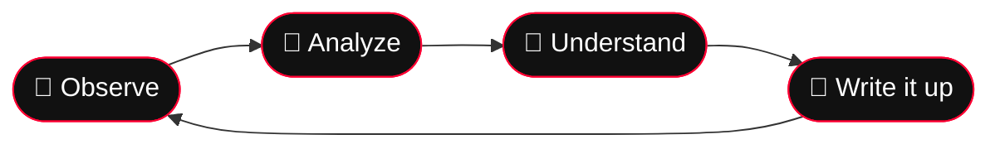

<div align="center">


<br/>


<br/><br/>

**✦ ━━━━━━━ 解析 ・ 逆行 ・ 理解 ━━━━━━━ ✦**

</div>

---

<table align="center">
<tr>
<td align="center">


</td>
<td>

```text
╭──────────────────────────────────────────╮
│ (๑•̀ㅂ•́)و✧  Analyst:                     │
│  "Welcome to my lab! Every binary        │
│   has a story, let's read it together~"  │
│                                          │
│ (¬‿¬)  Specimen:                         │
│  "Don't mind me, I'm just a harmless     │
│   specimen... in a sandbox... ♡"         │
╰──────────────────────────────────────────╯
```

```text
[USER]      null_byte0x
[FIELD]     Computer Science
[FOCUS]     Reverse Engineering
[INTEREST]  Malware Analysis
[VIBE]      ٩(◕‿◕)۶  always learning
[STATUS]    ████████░░  caffeinated
```

</td>
</tr>
</table>

## 

Hey! I'm **Abdulhakim** ✧, a Computer Science student exploring how software works beneath the surface.

- 🔬 Learning static and dynamic malware analysis
- 🧩 Practicing reverse engineering with IDA, Ghidra, and GDB
- 💻 Exploring C, C++, Python, assembly, and Linux internals
- 🚩 Practicing reversing and introductory pwn CTF challenges
- 🛡️ Learning defensive security and malware detection
- 📚 Building practical skills through labs, experiments, and write-ups

<div align="center">


</div>



---

## 

> `(ﾉ◕ヮ◕)ﾉ*:･ﾟ✧` **Analyst:** "My favorite tools, sorted by how often I open them!"

### 

<p>


</p>

### 

<p>


</p>

### 

<p>


</p>

### 

<p>


</p>

<sub>My learning toolkit evolves as I gain more hands-on experience.</sub>

---

## 

| Area | Current focus | Progress |
|---|---|---|
| 🔍 Reverse engineering | Assembly, control flow, strings and cross-references | `██████░░░░` |
| 🦠 Malware analysis | Static analysis, imports, PE structure and safe lab workflows | `█████░░░░░` |
| 💥 Binary exploitation | Stack layout, buffer overflows and ELF protections | `████░░░░░░` |
| 🐧 Linux internals | Processes, memory mappings, permissions and debugging | `██████░░░░` |
| 🐍 Security scripting | Python automation and CTF helper tools | `██████░░░░` |
| 🛡️ Defensive security | Indicators of compromise and detection fundamentals | `████░░░░░░` |

<sub>(edit the bars to match your real progress ✧)</sub>

---

## 

<div align="center">


</div>

---

## 

<div align="center">


</div>

I use CTFs and practical exercises to improve my problem-solving skills. I also document what I learn so other beginners can benefit from my notes.

> `٩(ˊᗜˋ*)و` **Analyst:** "Flag captured! …okay, that was just a strings dump, but still counts!"

---

## 

| Project | Description | Status |
|---|---|---|
| 🔎 RE Challenge Write-ups | Notes and solutions for reversing challenges | In progress |
| 🐍 Binary Analysis Scripts | Python utilities for learning binary formats | Planned |
| 🛡️ Malware Analysis Notes | Lab notes, static analysis and detection practice | In progress |

*Replace these examples with actual repository links when your projects are published.*

---

## 

When I'm not in a disassembler, I'm probably watching anime 🍜

| 📺 Currently watching | ⭐ All-time favorites | 📋 Plan to watch |
|---|---|---|
| *your anime here* | *your favorite here* | *your next one here* |
| *your anime here* | *your favorite here* | *your next one here* |

<div align="center">

`( ˘ ³˘)♡` *"Reverse engineering is just a mystery anime where the plot twist is in the .text section."*

</div>

---

## 

- [ ] Read x86/x64 assembly more confidently
- [ ] Improve static and dynamic malware analysis
- [ ] Practice debugging PE and ELF binaries
- [ ] Publish useful CTF walkthroughs
- [ ] Build Python reverse-engineering utilities
- [ ] Develop practical malware detection skills

---

## 

<div align="center">

<a href="https://github.com/null_byte0x">

</a>

<br/><br/>

`またね～  (ノ◕ヮ◕)ノ*:･ﾟ✧`


</div>
