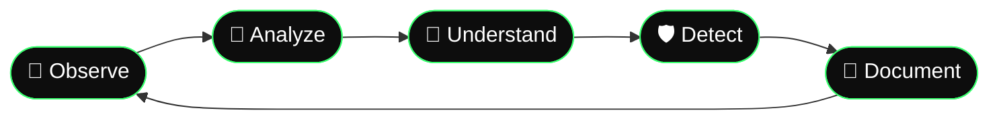

<div align="center">


[](https://git.io/typing-svg)

<br/>


<br/>

**✦ ━━━━━━━ 解析 ・ 逆行 ・ 理解 ━━━━━━━ ✦**

</div>

---

<table align="center">
<tr>
<td align="center">

[](https://git.io/typing-svg)

</td>
<td>

```text
╭─────────────────────────────────────────────╮
│  Analyst:                                   │
│  "Every binary has a story.                 │
│   I read them in a VM, not in prod."        │
│                                             │
│  Specimen:                                  │
│  "I am a harmless sample...                 │
│   totally not beaconing right now."         │
╰─────────────────────────────────────────────╯
```

```text
[ALIAS]     null-byte0x
[FOCUS]     Malware Dev & Analysis
[TOOLS]     IDA · Ghidra · x64dbg · GDB
[LANG]      C · C++ · Python · Bash · ASM
[STATUS]    ████████░░  always reversing
```

</td>
</tr>
</table>

---

## `$ cat about_me.md`

I'm **null-byte0x** — a security researcher sitting at the intersection of **malware development** and **binary analysis**. I study how malicious code thinks: how it evades, persists, communicates, and hides. Then I build detection for it.

On the dev side, I write research-grade code to understand techniques at a systems level — injection, evasion, persistence, shellcode. On the analysis side, I tear samples apart with static and dynamic tooling to document exactly what they do and why.

```text
 what I do
 ├── 🦠  malware development (research & educational samples)
 ├── 🔬  static & dynamic binary analysis
 ├── 🧬  reverse engineering — PE, ELF, shellcode, packers
 ├── 🛡️  detection engineering — YARA rules, IOCs, Sigma
 ├── 🌐  web exploitation — PHP webshells, LFI/RFI, SQLi
 └── 📝  write-ups, lab notes, and technical breakdowns
```



> ⚠️ **All research is conducted in isolated lab environments for educational and defensive purposes only.**

---

## `$ ls -la toolkit/`

### `[01]` Reverse Engineering
<p>


</p>

### `[02]` Malware Analysis
<p>


</p>

### `[03]` Languages
<p>


</p>

### `[04]` Detection & Lab
<p>


</p>

---

## `$ cat research_areas.md`

```
┌──────────────────────────────────────────────────────────────┐
│                                                              │
│  🦠  Malware Development                                     │
│       └─ PE injection · process hollowing · AV evasion       │
│           shellcode dev · C2 comms · persistence             │
│                                                              │
│  🔬  Binary Analysis                                         │
│       └─ static disassembly · dynamic sandbox · unpacking    │
│           memory forensics · API call tracing                │
│                                                              │
│  🧬  Reverse Engineering                                     │
│       └─ PE/ELF internals · obfuscation · packer analysis    │
│           control flow reconstruction                        │
│                                                              │
│  🛡️  Detection Engineering                                   │
│       └─ YARA rules · Sigma rules · IOC extraction           │
│           behavioral signatures · threat intel               │
│                                                              │
│  🌐  Web Security                                            │
│       └─ PHP webshells · LFI/RFI · SQLi · recon tooling      │
│                                                              │
└──────────────────────────────────────────────────────────────┘
```

---

## `$ ls projects/`

| Project | Description | Stack |
|---|---|---|
| 🔬 **malware-analysis-lab** | IOCs, YARA rules & write-ups for analyzed samples | `YARA` `Python` `Markdown` |
| 🛡️ **[Coming Soon]** | PE analysis toolkit | `C` `Python` |
| 💉 **[Coming Soon]** | Shellcode loader (research) | `C` `ASM` |
| 🌐 **[Coming Soon]** | Web exploitation toolkit | `PHP` `Python` `Bash` |

---

## `$ github-stats --user null-byte0x`

<div align="center">


</div>

---

## `$ cat disclaimer.txt`

> [!WARNING]
> **Read before using any tool or code in this repository.**

All research, tools, and code published by **null-byte0x** are developed strictly for:

- 🎓 **Educational purposes** — understanding how offensive techniques work at a technical level
- 🛡️ **Defensive security** — helping analysts and defenders recognize and counter real threats
- 🔬 **Controlled lab environments** — all testing is performed on isolated systems I own

```
1. Only use these resources on systems you own or have explicit written authorization to test.
2. Do not use this research to harm, exploit, or attack any individual or organization.
3. Unauthorized computer access is illegal in most jurisdictions worldwide.
4. The author (null-byte0x) holds zero liability for any misuse of these materials.
```

> *This is security research. The goal is understanding — not harm.*
> *If you're here to learn and defend, welcome. If not, look elsewhere.*

---

## `$ cat connect.txt`

<div align="center">

[](https://github.com/null-byte0x)

[](https://git.io/typing-svg)


</div>
